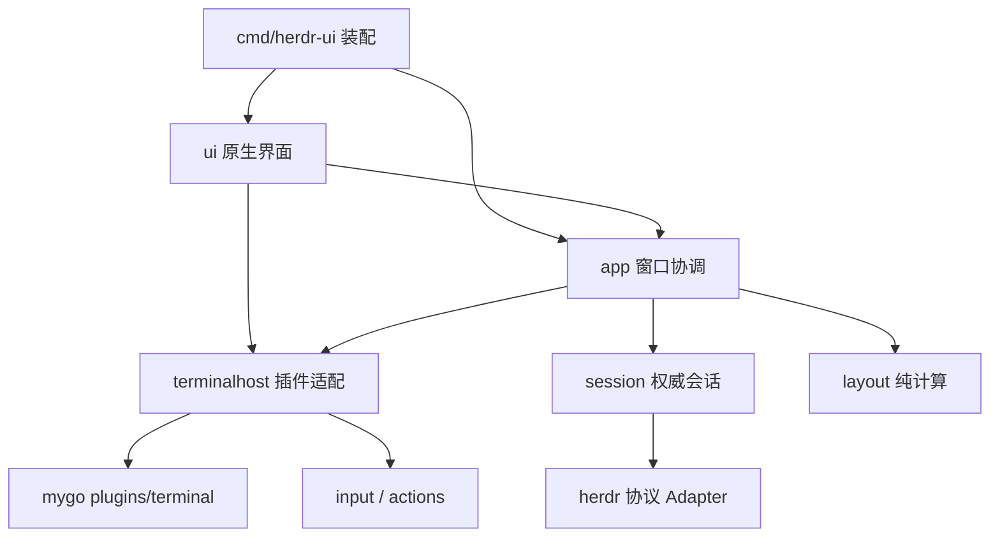
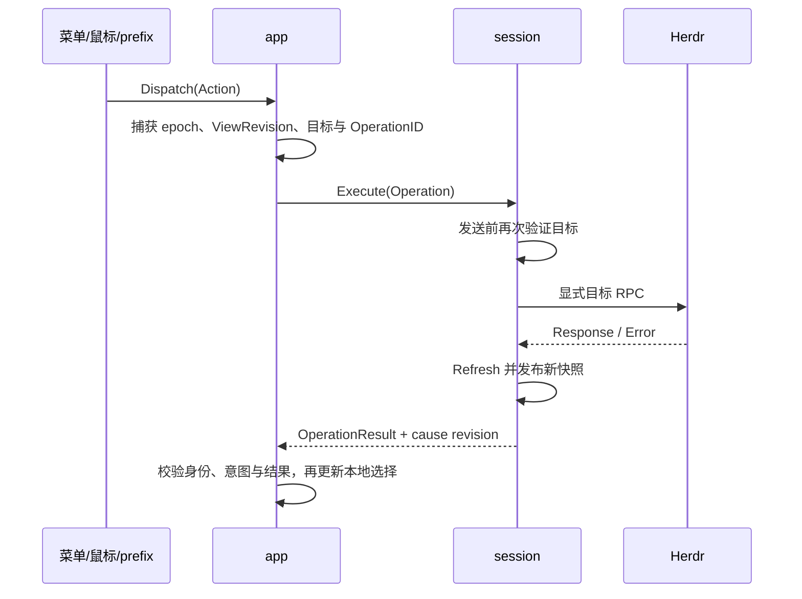

# Herdr UI · 第一版设计与实现方案

> 更新：2026-10-24。本文是第一版唯一的设计与实现规格，设计稿为 [docs.pen/new.pen](../docs.pen/new.pen)。M2 已在 M1 状态窗口上接入当前选择的单终端，见 [M2 验收记录](m2-validation.md)。M0 尚未通过的人工门槛继续保留在 [M0 验收记录](m0-validation.md)。M3–M4 尚未实现。

[范围](#scope) · [界面](#ui) · [架构](#architecture) · [同步](#sync) · [动作与布局](#actions) · [终端](#terminal) · [快捷键](#input) · [生命周期](#lifecycle) · [颜色](#colors) · [实施与验收](#acceptance)

<a id="scope"></a>

## 1. 产品范围与技术决策

Herdr UI 是本机已运行的 Herdr 守护进程的原生客户端：展示工作区、已打开工作树、代理状态与真实终端，支持已有标签切换、右分/下分、方向聚焦、调比例、zoom 和 prefix 快捷键参考。

采用 **Go + mygo 原生 UI + mygo 内置 `plugins/terminal`**。插件使用 Ghostty `libghostty-vt`，管理本地 PTY、VT、绘制、IME、普通输入、复制粘贴与尺寸同步，通过 `herdr terminal attach <terminal_id>` 连接真实会话。构建保持 `CGO_ENABLED=0`；应用只实现薄的插件适配，不自建终端内核、跨语言桥接或 painter。

图标使用 npm 包 **`lucide-static`** 作为开发期来源，按清单导出 SVG，通过 `go:embed` 和 mygo `ui.Icon` 使用；应用运行时不依赖 npm、Node 或在线图标服务。

状态从第一版起使用 `events.subscribe`。事件合并触发 `session.snapshot` 权威快照替换，没有定时状态轮询；终端文本不用于推断代理或工作区状态。JSON 状态链路与 attach 独立恢复。

第一版只连接本机，不启动/安装/升级守护进程。没有工作树打开或创建入口、Open Worktree 弹层、工作树删除、工作区关闭、代理启动和独立消息发送。PR、Issue、用量、端口、设备、云、派发、传送、代码审阅、插件设置、更新器、独立活动栏和 Overview 不纳入本版；不增加编辑器组或快捷键编辑页。

<a id="ui"></a>

## 2. 界面与交互

设计稿包含四张 1200 × 800 画板：01 Workspaces、02 Split Panes、03 Switch Tabs、04 Shortcuts Reference。视觉参考 corra：淡紫到奶油色的轻磨砂外壳、紧凑侧栏和白色圆角内容区。旧 `docs.pen/01.pen` 仅保留为设计源素材，不构成本版验收要求。

### 2.1 主窗口

默认 1200 × 800 逻辑像素，最小 820 × 560。侧栏默认 248px，可拖到 220–320px；隐藏侧栏后主面板占据剩余区域。窗口全屏与交通灯使用系统行为。

示意与画稿中的名称、分支、状态均为示例。当前 Herdr 会话快照没有分支字段；按§2.3的用户修正，侧栏由后台只读本地Git补充分支，路径仅在tooltip展示。无代理时不显示代理名称。

### 2.2 窗口外壳

- 左上为系统交通灯；右侧仅放隐藏侧栏按钮，不提供打开或创建工作树的入口。
- 磨砂与淡紫到奶油渐变使用本文 §9；右侧主面板距窗口顶部、右侧、底部各 8px，圆角 16px，与侧栏间隔 8px。设计外框圆角 24px，与内面板构成 8px 同心留白；运行时窗口外框使用系统行为。
- 侧栏分区间距为 6px，Workspaces 标题不加额外上下内边距；顶部按钮命中框保留 28px。
- 不显示旧稿的六入口活动栏。第一版只连接本机，连接路径可由启动参数提供，不做设备管理页。
- 实现中的 UI 字体用 macOS 系统 UI 字体；Pencil 不支持 SF Pro Text，设计稿 `font.ui` 使用 Inter 作为预览替代。正文 13px、辅助行 12px、分组标题 12px；终端默认等宽字体 13px，分屏时不自动缩小字号。保留系统字体回退。

### 2.3 侧栏中的 spaces 与 agents

按用户2026-10-23提供的Herdr侧栏截图修正信息模型；此节替代早期“路径副行和展开shell列表”的决定，保留原生界面风格。

- spaces按服务端工作区顺序显示真实名称、仓库来源图标、当前分支和非零ahead/behind计数。分支从明确的工作区checkout路径或权威pane顺序中第一个有效cwd对应的本地Git仓库读取；缺失不补造main。路径保留在tooltip，侧栏不展开终端提示符/主机名。
- 名称13px、分支12px，工作区主体42px，已确认监听端口单独22px一行展示。长分支/端口截断并提供完整tooltip，选中背景保持中性、焦点环独立。
- 仓库来源图标只使用真实origin类别：GitHub品牌、其它Git来源的通用图标，非Git路径使用目录。工作树仅在明确归属数据存在时缩进，不按名称猜组。
- 监听端口以真实pane shell进程后代为优先归属；独立启动的服务可按实际进程cwd在唯一规范化checkout路径内归属，使用路径边界、symlink规范化与进程出生标识防止误配。不能确认归属的端口不列入；端口仅显示，不新增启动服务或打开端口动作。
- agents是独立分区，按所属工作区分组，仅展示实际报告agent的pane：工作区名称、agent标识/名称、真实状态。普通shell不出现在agents；同名agent按pane ID区分，点击仍是窗口本地workspace/tab/pane选择。
- spaces状态采用服务端工作区聚合状态，不能因本窗口选中普通shell而隐藏其它pane的代理状态。普通工作区不挂未知状态问号；代理状态保留文字、图标及辅助名称。
- 当前session.snapshot不包含TUI的分支/端口缓存。本客户端的辅助采集在后台每5秒有界刷新本地Git和进程信息，来源未变化时复用身份缓存；JSON会话快照仍由订阅事件触发，无定时全量状态轮询。渲染不执行IO；源target/path/pane/terminal变化会取消任务，迟到结果只有身份匹配才安装。
- 底部保留本机连接状态与28px键盘说明入口，不添加工作区/工作树创建入口。侧栏展开/选择保持窗口本地状态，远端焦点不抢本地终端。

### 2.4 主内容区

- 按用户2026-10-24标注，移除工作区/标签/路径信息栏，终端直接填充内容区。侧栏隐藏时仅保留系统交通灯避让、窗口拖动和恢复侧栏的最小控制区。
- 标签切换、分屏和zoom保留在原生View/Terminal菜单及prefix中，不再绘制内容区布局工具栏。临时输入模式提示与必要错误仍可见。
- 终端填满头部以下区域，默认背景与主面板一致；内边距左右 16px、上下 12px。
- 右侧终端接入与 JSON 状态订阅使用独立连接/进程。attach 失败只在当前内容区显示错误和 Retry，不把状态订阅判为失败。
- 每个可见分屏持有独立 attach 客户端和终端视图，只有聚焦分屏接收键盘输入；切换焦点保留其它可见分屏连接。切换标签或工作区时释放不再展示的本地 attach，不终止 Herdr 持有的终端。实现前需验证终端适配层关闭时仅终止本地 attach 进程，以及 direct attach 的尺寸同步、快捷键与占用规则。
- 若终端正由另一客户端控制并要求 takeover，显示原因；第一版不自动接管。关闭 GUI 仅释放本应用连接，不关闭工作区或工作树。

### 2.5 已有标签

按用户最新标注，内容区不再展示标签选择器或标签编号；已有标签通过原生 View 菜单的 Next/Previous Tab 和对应 prefix 切换，不新增标签栏。

- 只使用真实tab记录，循环限制在当前工作区；不新建标签，不默认改变其它窗口选中项。
- 切换时恢复该标签有效的本地pane记忆，订阅仍处理标签创建、改名、移动与关闭；关闭当前标签时选择有效相邻项。
- 标签与布局动作继续共用Dispatch/Can及既有权威状态验证。

### 2.6 分屏与参考面板

按2026-10-24最新分屏参考图，多pane展示为独立圆角卡片：12px圆角、8px间距，间隙显示窗口外壳。32px轻量标识栏只使用明确的自定义pane label，普通shell使用通用Terminal标识；右侧徽标使用实际agent名称。没有可靠来源的模型/版本不生成徽标，不恢复工作区/路径/标签信息，也不使用pane ID或terminal title回退。单pane保持无标识栏的精简终端。点击卡片标识栏/终端或方向快捷键切换焦点。分隔拖动命中区至少8px，线条仅在hover/drag时显示。布局动作及权威数据规则见 §5。

快捷键入口为侧栏底部28px键盘按钮或 prefix+?。参考面板在右侧，宽344px、非模态、无scrim与焦点陷阱；关闭恢复终端焦点，Esc只在面板持有焦点时关闭，终端中的Esc照常送入终端。

参考面板打开时终端至少400px宽；不足则临时收起侧栏，关闭后恢复原状态。收起时最小窗口控制区预留系统交通灯区域，不恢复工作区/标签/路径信息栏；设计稿已检查820×560下的此状态。

<a id="architecture"></a>

## 3. 架构、Interface 与数据所有权

### 3.1 模块依赖



箭头表示代码依赖。只有 main 装配具体实现；app 不导入 ui，session 不导入终端插件。terminalhost 将插件控件和回调封装在一个实际需要的 Adapter seam，避免再拆一个只转发调用的 terminalview 包。

| Module / 包 | Interface | 隐藏的 Implementation |
|---|---|---|
| `internal/herdr` | Call、Subscribe | NDJSON、socket、请求 ID、读写限制 |
| `internal/session` | Start、Latest、Execute、Refresh、Close | 引导、订阅、dirty 合并、重连、快照与操作队列 |
| `internal/app` | View、Dispatch、Shutdown | 本地选择、pending 意图、结果验证、终端需求 |
| `internal/terminalhost` | Reconcile、View、Status、Close | 插件 New/View/Close、实例代次、OnKey/OnScroll/OnExit 适配 |
| `internal/ui` | 渲染 AppView 并回传 Action | 外壳、侧栏、分屏容器、菜单与参考面板 |
| `internal/actions` | 用户意图值类型 | 动作 ID 与参数；不执行 IO |
| `internal/input` | BindingResolver、PrefixMachine | 绑定、prefix/resize 状态；普通编码由插件负责 |
| `internal/layout` | Project、HitSplit、ResolvePath | DIP 几何、树路径、结构指纹 |
| `internal/design` | 语义 token 与插件主题映射 | 亮暗、材质、字体与尺寸 |
| `internal/icons` | 具名 `*ui.SVG` 图标 | 按需嵌入、一次解析与生成资源；不加载整套图标库 |

Session 发布不可变模型，不暴露可写 map/slice。插件对象只由 terminalhost 持有；UI 通过 host.View 显示指定 binding，不读取插件私有字段。terminalhost 不拥有 workspace 数据，业务动作经注入的 dispatch 回到 app，不直接改变全局 focus。

### 3.2 身份与所有权

#### 身份规则

| 值 | 作用域与含义 |
|---|---|
| SessionTargetID | 本窗口选定的逻辑会话目标；显式换目标时重新分配，普通 JSON 重连保持不变，即使 socket 字符串相同也不跨显式目标切换复用 |
| SessionEpoch | JSON 连接生命周期；重连后递增，仅约束状态/RPC 消息，不作为被保留 attach 的身份 |
| SnapshotRevision | 本客户端成功安装快照的单调序号；不是 Herdr 服务端事件 sequence |
| SubscriptionGeneration | 同一 SessionEpoch 内某组订阅的代次；旧连接关闭通知不得关闭新连接 |
| WorkspaceID / TabID / PaneID | Herdr 返回的业务身份；不从序号、名称、路径推导 |
| TerminalID | attach 目标；与 PaneID 明确区分，禁止隐式互转 |
| TerminalGeneration | 本地一次 attach 生命周期；重新打开相同 TerminalID 仍递增 |
| OperationID | 一次客户端动作；用于 pending 与响应匹配，不声称服务端有幂等去重能力 |
| ViewRevision | 本窗口用户选择/视图需求的版本，阻止迟到动作结果抢回焦点 |
| LayoutFingerprint | 布局树的 pane 身份与拓扑摘要；比例另存，拖动时不将自身比例回显误当成结构变化 |

状态/RPC 完成消息附 SessionTargetID 与 SessionEpoch；终端消息附 SessionTargetID、TerminalID 与 TerminalGeneration，不绑定 JSON 连接 epoch。需要改变选择的操作另捕获 ViewRevision。仅 epoch 匹配不够：用户可能在同一连接中已经切到另一个标签。

#### 不可变数据

`session` 内部将 wire DTO 校验为自己的 `Snapshot`：维护 ID 索引和权威顺序，保留必要的未知状态原值。发布后不再修改 map/slice；导出查询方法不泄漏可写容器。新快照创建新对象，UI 可继续读取旧对象直到替换。

`AppView` 是 UI 线程生成的当前显示投影，包含侧栏行、标题、标签、pane 几何、连接状态与动作可用性；不把全部 JSON DTO 交给 UI。派生数据只在 SnapshotRevision、ViewRevision、尺寸或主题变化时重算，不在每个字符刷新时重建工作区树。

终端网格、字形缓存和绘制状态由插件拥有，应用不再定义 Go Frame 或跨语言快照。mygo UI 线程显示插件 View，后台回调仅发布本地 attach 状态；插件自身负责内容刷新。

### 3.3 核心 Interface

会话接口保持不变：

```go
type Session interface {
    Start(ctx context.Context, notify func())
    Latest() PublishedSnapshot
    Execute(ctx context.Context, op Operation) <-chan OperationResult
    Refresh()
    Close(ctx context.Context) error
}
```

Start 只调用一次并立即返回。Latest 返回不可变结果；notify 可以合并且不直接修改 UI。Execute 返回容量为1的结果通道，一次结果后关闭，取消接收不阻塞 worker；队列满返回 Busy。Operation 是明确目标的 Neighbor、Split、Zoom、SetRatio、Scroll 等闭合操作，不用泛型 RPC 暴露给 UI。Refresh 只置 dirty，不创建并发快照。Close 有界且幂等，后台执行。

terminalhost 的方法形状为：

```go
// 以下是待实现的适配契约，不是插件本身的方法。
Reconcile(desired []TerminalSpec) (Bindings, error)
View(c *ui.Context, binding Binding) ui.Element
Status(binding Binding) AttachStatus
Close(ctx context.Context) error
```

Reconcile 在 UI 线程验证需求并更新实例注册表，不做等待网络的工作。需要插件 Load/New 的初始化先由后台准备，完成后经 Window.Update 安装；初始化任务附目标和代次。插件 Command 模式的真实进程启动由插件完成，所有 OnKey 等 UI 钩子安装在创建 options 时。新实例若已被移出 desired，迟到 New 结果只关闭，不显示。View 只访问已经安装且仍有效的实例，一个 Terminal 同时显示一个 View。

Binding 包含 SessionTargetID、TerminalID、TerminalGeneration；reconcile 接受需求时分配并返回。创建错误更新对应 AttachStatus，不能让后台错误回调直接关闭整个窗口。插件 OnTitle/OnExit 来自后台，必须经身份和 closed 检查后提交 UI；插件 OnKey/OnScroll 在 UI 线程，仅更新状态或发起异步动作。

插件 New 接受 Options.Command/Env，不留空 Command，不重复创建 PTY。初始化失败不自动启动 shell。尺寸由 View 和插件管理；应用不提供与插件竞争的 Resize/Submit/LatestFrame 接口。普通键盘、鼠标、IME、粘贴直接由 View 处理，prefix 通过 OnKey 消费动作；特殊传输转义使用插件 Send。

app 的 View/Dispatch 只在 UI 线程调用，Dispatch 不阻塞 IO。Shutdown 先标记 closed，再让后台关闭 Session 和 terminalhost。解绑 View 后才清理插件实例，避免 UI 绘制正在关闭的对象。

### 3.4 并发与背压

UI 线程拥有窗口选择、菜单、prefix 和实例注册表；session coordinator 拥有会话状态机；插件拥有自己的 PTY、解析、输入队列和渲染同步。应用不插入第二套终端 worker/命令队列。

| 链路 | 应用规则 |
|---|---|
| 状态失效 | 合并为 dirty；订阅断线不能被普通 dirty 覆盖 |
| 快照通知 | 保存 latest，只安排一个待执行 Window.Update；清 pending 后复查版本，避免最后一次更新丢失 |
| 普通 Operation | 串行，初始上限32；满则 Busy；重复 split 在入队前拦截 |
| SetRatio / Scroll | 每个明确目标一请求在途＋一个最新 pending；替换 pending 返回 Superseded，不回放历史位置 |
| 插件内容刷新 | 插件自行触发，应用不复制网格、不按字符 post Update |
| 插件生命周期回调 | 携带目标/代次，旧回调不得影响新实例；退出事件必须处理 |
| 终端输入与 resize | 交给插件维护实际时序；应用不声明插件未提供的队列容量、viewport revision 或拒绝语义 |

session 请求 lane 串行处理读写；最多一次快照在途，在快照之间公平调度已接受 Operation。订阅读取独立。持续输出、大粘贴、resize 交错下的插件响应性在 M0 验证；问题通过最小插件修复处理，不能默默加一套自建终端实现。

JSON 状态链路与插件链路分别恢复。显式换目标时先解绑旧 View、关闭旧实例，再显示新目标；后台准备新实例不能令旧目标的回调被误接到新界面。

### 3.5 图标资源与生成

通用操作、布局与状态图标使用 `lucide-static`，沿用设计稿的 Lucide 风格；agent 品牌图标使用 `@lobehub/icons-static-svg`。两者均使用静态 SVG，不引入 React 组件包。新增构建工具时，将包以精确版本写入 devDependencies，并提交 lockfile；图标升级通过显式更新版本和重新生成完成，不在构建过程中使用浮动 latest。

资源链路固定为：

```text
lucide-static / @lobehub/icons-static-svg
    → icons 清单 → 按需导出/生成 → internal/icons → ui.Icon / ui.Image
```

- `scripts/icons.mjs` 读取清单，只导出实际使用的图标到 `internal/icons/svg/`，生成 `internal/icons/icons_gen.go` 的具名变量。清单、脚本和生成结果均入库；普通 Go 构建只使用生成文件，不要求本机先安装 Node/npm。
- 生成器通过 `go:embed` 嵌入 SVG，使用 `ui.MustParseSVG` 在初始化时解析一次；渲染过程中复用 `*ui.SVG`，不逐帧读取或解析文件。Go 调用形式为 `ui.Icon(c, icons.PanelLeft)`。
- 图标颜色由 `TextColor` 读取本文 token，尺寸由 `Size` 或 `FontSize` 控制。保留原 SVG 的 viewBox、描边宽度和端点风格；工具栏命中框仍至少28px，不能把图标视觉尺寸当作点击区域。
- 状态图标为12–14px，常规工具栏图标为16px；图标与其 tooltip、按钮 Label、原生辅助名称共同定义，纯装饰图标不重复朗读。
- 脚本对缺失名称、重复 Go 标识符或无效 SVG 明确失败，不回退为其他图标。生成结果应确定且可重复，验证覆盖清单完整性、所有导出图标可被 mygo 解析，以及重新生成无差异。
- 当前 `assets/icons/` 是设计稿素材，保留其来源及授权；应用资源以锁定的 npm 版本生成。生成资源随包保留所用 Lucide 版本的许可证/版权声明。现有 `github.svg` 来自 Simple Icons，保留独立授权，不能将其标为 Lucide 来源；第一版未使用的品牌图标不自动打包。

上述路径与脚本是待实现安排，当前只确定选型。无需引入 React/Vue 图标组件、图标字体或运行时远程下载。

#### Agent 品牌图标

采用 [Lobe Icons 静态 SVG 包](https://github.com/lobehub/lobe-icons#-packages)。已核实其图标目录包含 Claude Code、Codex、Gemini CLI、opencode、Github Copilot、Cursor 等；实际导出时以锁定包版本内的文件为准，不猜文件名。

| Herdr agent 身份 | 品牌图标 |
|---|---|
| Claude Code | Claude Code |
| OpenAI Codex | Codex |
| Gemini CLI | Gemini CLI |
| OpenCode | opencode |
| GitHub Copilot | Github Copilot |
| Cursor | Cursor |

- 在 `internal/icons` 维护显式 agent 标识映射，按 Herdr 返回的已识别 agent 类型选图；显示名、终端标题和所用模型名不作为模糊匹配依据。别名只接受清单中明确列出的值。
- 单色品牌图标使用 `ui.Icon`，跟随 `icon.default` / `icon.active`；彩色版本使用 `ui.Image` 保留自身颜色，不强制染为 UI 状态色。首版侧栏优先采用单色版本，并验证亮暗背景下的辨识度。
- 品牌图标用于身份，状态仍使用独立的 Lucide 图标。例如品牌标识在名称前，working/blocked/done 图标在行尾；不以改变品牌颜色替代状态提示，不增加常驻状态文字。
- agent 图标默认16px，保留42px紧凑两行布局；tooltip/辅助名称包含真实 agent 名称。未知或无对应素材的 agent 使用 Lucide `bot`，普通无代理终端使用 `terminal`，不冒充相似品牌。
- 品牌资源与通用图标共用生成脚本和嵌入流程，但导出清单记录各自的包、版本、原始文件和显示方式，避免同名覆盖。缺失已配置文件属于生成错误；未知运行时 agent 才走通用回退。
- 导出并保留 Lobe Icons 的 [MIT 许可证和版权声明](https://github.com/lobehub/lobe-icons/blob/master/LICENSE)，与 Lucide、现有 Simple Icons 的来源分别记录。品牌展示使用对应标识，不暗示产品背书。
- 验证覆盖已配置 agent 映射、未知 agent 回退、彩色/单色渲染、亮暗对比和独立状态图标。SVG 需通过 mygo 实际解析；若使用其不支持的效果，先选兼容的静态版本，不引入浏览器渲染依赖。

<a id="sync"></a>

## 4. Herdr 协议、数据与实时同步

### 4.1 研究基线与数据契约

以下对应本地源码基线：mygo `80afe0a`、Herdr `7c34cf2`。这是研究基线，不表示仓库已锁定这些依赖；创建工程时必须固定可构建版本并记录完整 commit、Go/mygo CLI 版本与目标架构。

| 能力 | 已核实入口 | 实现约束 |
|---|---|---|
| 内置终端绘制 | mygo `plugins/terminal/view.go` 的 `View` | 应用直接显示插件控件，不创建字符元素或自定义 painter |
| 文字排版与网格 | mygo `plugins/terminal/paint.go` 及插件内核 | 排版、字形缓存与网格归插件持有，应用只设置公开 Font/Theme |
| 系统 IME | mygo `plugins/terminal/view.go` 的输入/组字处理 | 插件持有预编辑与提交逻辑；应用只验证 prefix 钩子与组字配合，不重写 TextInputClient |
| UI 线程更新 | mygo `content.go` 的 `Window.Update` | 后台结果经异步 Update 提交，不在回调中等待同一 UI 线程 |
| 后台请求重绘 | mygo `ui/services.go` 的 `Services.Invalidate` | 任意 goroutine 可调用；它不使模型字段自动获得并发安全 |
| 状态引导 | Herdr `src/api/schema/session.rs`、`src/app/api/session.rs` | 有工作区、标签、面板、布局、代理及服务端焦点，没有终端字节流 |
| 订阅 | Herdr `src/api/schema/events.rs`、`src/api/server.rs:700` | 先返回 `subscription_started`，后续保持连接推送；订阅集合固定，更新集合需新建连接 |
| 代理状态 | `Subscription::PaneAgentStatusChanged` | 必须指定 pane ID；不能发送无 ID 的假全局通配订阅 |
| 布局 | `PaneLayoutSnapshot`、`layout.export`、`layout.set_split_ratio` | 快照提供矩形列表；修改比例需树路径，不能拿 split 的字符串 ID 当路径 |
| direct attach | Herdr `docs/next/website/src/content/docs/persistence-remote.mdx`、`src/client/attach.rs` | 输出当前渲染状态与后续 ANSI 帧，并非原始程序 PTY 历史；每个 terminal 只有一个可写 owner |
| 生效键位 | Herdr `src/config/model.rs`、`src/config/keybinds.rs` | 当前 JSON 方法清单没有生效键位查询 API；不能虚构 `config.get` |

本项目直接依赖 mygo 终端插件的公开 New/Options/View/Close，不访问 internal/vt 或复制私有绘制逻辑。mygo 的材料、系统菜单与交通灯行为仍需真实窗口验证；静态设计稿不能证明原生效果已经可用。

`SessionView` 至少含 Workspace/Tab/Pane ID 索引、按 pane_id 关联的代理展示记录、服务端顺序数组、按 workspace+tab 索引的布局、服务端焦点、版本/协议和最近成功同步时间。单独保存 `WindowSelection`：workspace、tab、pane、各工作区上次选择；服务端 focus 变化不覆盖仍有效的本窗口选择。

状态图标按实际 `AgentStatus` 映射：working→紫色 activity，idle→灰色 circle，blocked→琥珀色 message-circle，done→绿色 check，unknown/未知新值→灰色 circle-help。当前 schema 没有 failed 状态；红色 circle-alert 用于明确的本地错误，不从进程退出或未知值推断代理失败。根行单图标采用本窗口当前标签/面板的状态，多面板展开后分别显示，不额外发明聚合状态字段。

当前快照没有普通工作区或 worktree 的分支字段。侧栏第二行优先展示已打开工作树的 checkout_path（截短显示），普通工作区按本窗口该工作区的选择回退规则定位 pane，显示其 PaneInfo.cwd（WorkspaceInfo 自身没有 cwd）；字段缺失则留空，保持 42px 行高。画稿中的 main、worktree/fix-login 仅是分支示例，当前基线不承诺显示分支；本版不为此增加 Git 子进程或 worktree.list 查询。AgentInfo 没有独立 agent_id，代理记录按 pane_id 关联，并核对 terminal_id 以识别 occupant 替换；相同代理名称不作为合并键。

所有面板均使用 `PaneInfo.pane_id` 做业务目标，使用 `terminal_id` 做 attach 目标。pane ID 改变或 terminal ID 替换时重新核对映射；不能把两种 ID 互换或只按标题复用控件。

### 4.2 连接与订阅

状态依次为 `Disconnected → Connecting → Subscribing → Bootstrapping → Ready`，可进入 `Resyncing`、`Reconnecting` 或 `Incompatible`。终端 attach 状态独立为 `Starting / Attached / Unavailable / Failed / Closed`。

#### 请求链路

Unix socket 上使用逐行 JSON，形如 `{"id":"e3-r7","method":"session.snapshot","params":{}}`。请求 lane 与订阅连接分离；普通 RPC 串行执行并按 id 校验响应。M1 已实测 Herdr 普通请求处理一条后关闭连接，因此每次 RPC 新建 socket；这不是失败后的请求重放。订阅连接保持长连接，不混用普通 RPC。解析器显式设置行长度上限，不能使用默认 64KiB Scanner 限制接收快照；首版默认上限 16MiB，超出时显示协议/容量错误，不截断 JSON。

启动参数提供显式 socket override，并优先于环境变量；未指定时遵守 Herdr 的 `HERDR_SOCKET_PATH`、`HERDR_SESSION` 和默认配置目录规则。所有 attach 子进程继承同一个解析后的 socket 目标，不能状态连接 named session、终端却落到默认 session。启动时执行 `ping` 并读取实际 CLI/schema 基线；不把 reference 中的 protocol 22 当作所有 JSON 客户端的永久兼容条件。direct attach 仍受 Herdr CLI 与服务端协议兼容约束。

连接和普通 RPC 初始超时 5 秒。失败不自动重放有副作用的请求；请求超时表示结果未知，先同步快照，再由用户重试。重连采用带抖动的 250ms、500ms、1s、2s、最高 5s 退避，可取消；这是重连调度，不是状态轮询。Ready 后没有定时快照任务。

#### 订阅引导

1. 新建会话代次，建立生命周期订阅，等待 `subscription_started`。订阅 workspace、tab、pane 生命周期、layout.updated 与 worktree 生命周期，先缓冲变化信号。
2. 请求一次快照，提取所有 pane ID。生命周期事件负责发现新增/移动/关闭面板，不能依赖当前可见面板才订阅代理状态。
3. 为这组 ID 建立第二条批量代理状态订阅，每项指定 `pane_id` 且不设置状态过滤；等待确认。无 pane 时省略该连接。
4. 再请求权威快照，覆盖代理订阅建立之前的状态变化。pane 集合若发生变化，重建代理订阅并补取快照；没有变化则发布当前结果。持续事件期间允许发布完整快照，不等待整个会话永远静止。
5. 后续每个事件只标记 dirty 并请求刷新。刷新进行中只再标记 dirty；完成后若仍 dirty，立即再取一次，不并发堆积请求。同一批事件在一次 UI 帧内合并，持续输出不能令刷新永久防抖等待。

在建订阅期间 pane 可能已经关闭或移动；若批量订阅返回目标不存在，先补取快照再按新 ID 集合建订阅，不把这种竞态误报为协议不兼容。

更换代理订阅时先让新集合订阅确认，再关闭旧连接；重叠事件只造成合并刷新，不重复业务动作。任一有效订阅断开都将缓存标记 stale，重建所需订阅并补快照；旧代次的通知不生效。

服务端按订阅逐项 poll，公开事件没有可用于客户端全局排序的 sequence。因此缓冲区记录“需要重新获取状态”，不把多个订阅的 payload 当作全局有序日志回放到新快照上。已知生命周期事件到达时可立即让相关操作失效，完整数据仍以新快照替换为准。未知事件记录一次诊断并触发同步；未知新增字段忽略，未知状态显示中性图标，缺关键 ID/布局字段则拒绝该快照并显示兼容错误。

### 4.3 同步状态机约束

在上述引导流程中，状态与重试由 coordinator 统一拥有：

- coordinator 独占 epoch、状态、active subscription generations、dirty 和 snapshot-in-flight；Reader 只带代次报告 Ack/Dirty/Disconnected。
- 普通订阅 EOF、请求连接失败、pane 订阅探测时目标消失、schema 错误分开处理。订阅 EOF 由 coordinator 重建，不允许 Reader 自己无限重连。
- 代理订阅替换先建后拆，同一 pane 集合的旧/新重叠只触发 dirty。旧集合的主动关闭是 expected-close，不触发 Reconnecting。
- 发布快照前完成基本引用校验；布局缺失可显示局部加载/不可用，不创建假的 pane。已存在布局引用不存在 pane 时触发补同步；持续不一致再显示兼容错误，不能无限重试。
- 会话未 Ready 时禁用修改动作。Resyncing 使用完整旧视图加 stale 标记；收到新快照后一次发布，不能清空侧栏再逐条填入。
- snapshot-in-flight 期间 dirty 单独记录请求开始后的信号，结果安装后再刷新；不靠“收到了快照就清所有 dirty”结束，从而漏掉在途变化。

状态同步模块不执行本地选择，不通过 snapshot.focused_* 强制改变窗口焦点。Attach 继续工作时，JSON 状态链路断开不会自动终止终端。终端回调按 SessionTargetID＋TerminalGeneration 校验，JSON SessionEpoch 更新不影响插件画面刷新；状态 stale 时暂停基于旧映射的新业务动作。新快照确认同一目标的 pane→terminal 映射与仍存活 attach 一致后，复用原 generation 并恢复依赖权威状态的业务动作。若映射不符或 attach 已退出则关闭重建。显式换目标总是分配新 SessionTargetID 并关闭旧终端；旧目标通知即使 terminal 字符串相同也丢弃。这样不需要把旧 worker 伪装成新的 JSON epoch，也不会因状态重连重启保留的终端实例。

<a id="actions"></a>

## 5. 动作、结果与布局

### 5.1 本地选择与显式目标

选择回退顺序：仍有效的本窗口记录 → 快照中对应范围的服务端聚焦项 → 服务端顺序中的首个有效项 → 空态。当前对象关闭后回退；后台 focus 变化只更新权威缓存，不抢走本窗口终端。

工具栏、原生菜单和 prefix 共享一组动作。执行时捕获 sessionEpoch、workspace/tab/pane ID，排队前和发送前再次验证，禁止省略目标而误操作服务端全局焦点。

| 动作 | 实现及副作用 |
|---|---|
| 选工作区/标签/面板 | 只更新本窗口选择与 attach 差量；不调用 workspace.focus/tab.focus/pane.focus |
| 下一个/上一个标签 | 在当前工作区权威顺序中循环；一个标签时不可用 |
| 方向聚焦 | `pane.neighbor` 携带当前 pane ID、方向，取返回 neighbor 后更新本地选择；不调用改变全局焦点的方向 focus 方法 |
| 右分/下分 | `pane.split` 显式指定 `target_pane_id`、workspace、direction、ratio=0.5、focus=true；成功后同步快照并在本窗口选新面板 |
| 放大/恢复 | `pane.zoom` 指定 pane ID、mode=toggle；这是服务端共享布局变化，收到权威结果后刷新 |
| 调整比例 | `layout.set_split_ratio` 指定 tab ID、path、ratio；同一 split 串行且只保留最后一次待发送比例 |
| 侧栏与参考面板 | 本地 UI 动作；不发 RPC |

分屏的 `focus:true` 会改变 Herdr 服务端焦点，这是创建操作已有的明确副作用；普通浏览和方向切换仍保持本地。若希望分屏也不改变全局焦点，需另行修改该决策，不能在实现中悄悄混用两套语义。

创建和布局动作 pending 时禁用重复提交；响应与事件都可能先到，事件只刷新，成功响应只消费一次本地选择意图。请求例子（均为协议示意，ID 来自当前快照）：

```json
{"id":"e3-r8","method":"pane.split","params":{"workspace_id":"w1","target_pane_id":"w1:p1","direction":"right","ratio":0.5,"focus":true}}
{"id":"e3-r9","method":"pane.neighbor","params":{"pane_id":"w1:p1","direction":"left"}}
{"id":"e3-r10","method":"pane.zoom","params":{"pane_id":"w1:p1","mode":"toggle"}}
{"id":"e3-r11","method":"layout.set_split_ratio","params":{"tab_id":"w1:t1","path":[false],"ratio":0.6}}
```

split 超时后不自动再创建；提示“结果待确认”，同步后再允许用户操作。

### 5.2 执行结果与竞态



快照/响应到达没有固定先后。OperationResult 保存服务端返回的目标引用与执行结果；app 将新选择记为 pending intent，直到完整快照确认目标存在，再一次性应用。若结果之前已收到目标快照，也可立即应用。任何浏览动作提升 ViewRevision，旧 split 成功结果仍更新数据，但不再将用户从新标签拉回旧标签。

SetRatio 不进入普通 FIFO 积累历史值。以 `(SessionTargetID, epoch, tab, LayoutFingerprint, split path)` 为键，每个 split 最多一个在途请求和一个可覆盖的 pending ratio；新的比例替换 pending，旧 pending 返回 Superseded（明确未发送）。释放鼠标的最后比例仍写入该槽；在途完成后只发送最新值。结构变化、目标失效或 epoch 变化立即取消 pending；不同 split 之间保留普通操作的公平调度。该规则同时适用于鼠标拖动和 resize 模式，不因 50ms 节流而省略。

Error 分为 Rejected（明确未接受）、NotSent（发送前失败）、OutcomeUnknown（已写出但响应丢失/超时）、StaleTarget、Busy、Superseded 和 Closed。OutcomeUnknown 不自动重试 Split/Zoom；只刷新，并保留“结果待确认”。后续快照能显示结果，但没有服务端 OperationID 关联时不能仅凭新增了一个同名 pane 就断言那是本次 split 的结果。

取消动作只取消等待/尚未写出的工作；已写出的远端修改不能撤销。app 失去选择意图后也必须排空/释放结果资源，不让结果 channel 或迟到的插件实例泄漏。

### 5.3 布局树与可见终端

`PaneLayoutSnapshot` 提供 area、pane rect、split rect 和 zoom 状态。先把网格矩形投影到内容区 DIP，统一计算边界，多pane在DIP投影后只收缩内部共享边缘各4px，保留外边界，再扣除卡片32px标识栏、2px边界和插件自身内边距；单pane不扣卡片标识栏或边界。相邻 pane 共享同一个边界计算，避免浮点取整造成缝隙。

比例编辑需 `layout.export` 的树结构：按 first=false、second=true 生成 path，并将节点与快照 split 对应。开启拖动/resize 模式前取最新树；不能从 split.id 猜路径。树结构变化使当前拖动代次失效，取消预览并恢复权威布局。本地 `src/layout.rs:650` 已核实 false=first、true=second；集成测试仍需验证导出树、split 命中与修改的是同一节点。

拖动使用本地预览以保持跟手；最多每 50ms 发送一次比例，释放时补最后值。同一 split 单请求在途；布局事件更新基线，失败或结构改变回滚。每次实际视口变化由插件 View 同步网格与本地 PTY；应用不再发送竞争 resize，零尺寸/隐藏项不预建实例。

`terminalhost` 对比当前需要显示的 terminal ID 集合：保留不变连接，新增则 attach，移除则释放。zoom 隐藏的 pane 也退出可见集合，恢复后重新 attach；因此不保留它们的本地滚动/选择状态。attach 已被占用时原位解释，不自动使用 takeover。应用退出取消所有工作任务并回收子进程，但不向 Herdr 发送关闭工作区/面板的操作。

<a id="terminal"></a>

## 6. mygo 内置终端接入

### 6.1 插件能力与实例管理

本地源码：`mygo/plugins/terminal/terminal.go`、`view.go`、`library.go`，研究基线见 §4.1；正式接入固定实际可构建版本。

| Interface | 本项目使用方式 |
|---|---|
| `terminal.New(Options)` | Command 显式传 Herdr 可执行文件和 attach 参数；绝不留空以免启动默认 shell |
| `terminal.View(c, term)` | 显示已有 Terminal，插件负责绘制、输入、选择、复制粘贴与滚动；一个 Terminal 同时只显示一个 View |
| `Options.Command / Env / Dir` | 参数数组启动；Env 覆盖同一解析后的 HERDR_SOCKET_PATH；Dir 使用实际可访问路径 |
| `Options.Font / Theme / DarkTheme / Padding / Transparent` | 接入颜色与材质 token；默认 Padding 会产生额外留白，显式设置并避免外层重复 padding |
| `Options.OnKey` | 在插件键位和编码前截获 Herdr prefix；返回 true 同时消费关联文字和 release |
| `Terminal.Send([]byte)` | 已处理的传输序列按插件输入顺序发送；仅用于明确的 attach 转义，不替代插件通用键盘编码 |
| `Options.OnScroll` | 插件本地历史滚动前截获整行 wheel，按服务端历史控制处理；程序接管鼠标/alternate-scroll 时可能不调用该钩子 |
| `Options.OnClear` | 消费本地清屏动作，避免只清客户端画面而被服务端重绘覆盖；首版不增加远端清屏功能 |
| `Options.OnTitle / OnExit` | 插件 goroutine 回调，经身份/代次校验后 Window.Update，不直接修改 UI 模型 |
| `Options.OnZoom` | 接入统一字体尺寸动作或消费默认缩放；不要与 Herdr pane zoom 混为一谈 |
| `Options.ClipboardRead` | 默认拒绝程序读取系统剪贴板，保留插件明确策略；用户主动粘贴走插件 |
| `Terminal.Close()` | 关闭本地 PTY/attach 并释放插件资源；本地程序收到 SIGHUP，插件有未退出进程的后续清理 |
| `terminal.Load / LibraryPath` | 检查 libghostty-vt；打包应用使用内置资源，不依赖启动时下载 |

`Options.Conn` 和 `ResizeByConn` 是插件可选扩展，本版先使用 Command 模式，不自行再创建一套 PTY。只有 M0 证明 Command 模式无法满足 direct attach 的尺寸/输入契约时，才评估最小 Conn Adapter；不能未经验证就假定需要或已经具备该桥接。

### 6.2 Herdr 适配职责

`internal/terminalhost` 维护按 SessionTargetID、TerminalID 和 TerminalGeneration 索引的条目，封装 New/View 所需实例与 options。它持有 attach 生命周期，不持有工作区数据，也不复制插件网格。

- 每个可见终端一个实例；切换工作区、标签或 zoom 后按 desired 集合保留、新建、关闭。插件一个实例只显示在一个 View 中。
- 首帧有效尺寸前不创建隐藏终端；插件 Command 模式会在 View 得到尺寸时启动，未显示实例可能 500ms 后以 80×24 启动，因此不提前缓存一批未显示实例。
- 插件 View 自动计算并同步网格与 PTY 尺寸，应用负责外层分屏几何，不再同时调用另一套手工 resize。
- 同一会话 JSON 重连不重建仍有效的 Terminal；显式换 socket/目标或 pane→terminal 映射改变时关闭旧实例，旧 OnExit 不影响新实例。
- 生命周期回调同时检查 closed、SessionTargetID 与 TerminalGeneration；OnExit 标记本地 attach 结束，不能据此关闭整个工作区或判定远端代理失败。
- Close 在脱离 UI 后的清理任务执行；不按进程名杀 Herdr，不调用 workspace.close/pane.close。关闭本地 attach 不终止 Herdr 真实会话需实测。

### 6.3 服务端滚动、清屏与颜色

Herdr attach 输出的是服务端重绘画面，本地 scrollback 不等于 Herdr 完整历史。使用 OnScroll 消费本地滚动，通过 `pane.scroll` 的 `offset_from_bottom` 更新服务端视口；初始指标从 pane 信息读取，当前可见 pane 使用有 ID 的 `pane.scroll_changed` 订阅更新。

滚动目标按当前已知 offset、rows 和服务端范围计算，连续滚动积累到同一 pending target，不因慢响应反复从旧 offset 计算；一请求在途，保留最新目标，失败回到权威值。初版不显示无法确认范围的自制历史滚动条。程序接管鼠标或 alternate-scroll 时保留插件编码，让 attach 处理，必须实测两条路径。

OnClear 消费本地清屏请求，首版不允许“只清本地”破坏服务端画面；如保留插件上下文菜单，不能显示点击无反馈的可执行项，应禁用或说明不可用。默认插件搜索、链接等能力不因此扩展首版产品范围。

终端主题映射使用插件公开 Theme；外壳继续使用设计 token。服务端已输出 RGB 的画面不能在本地当作 ANSI 索引重新着色。减少透明度时关闭 Transparent，程序显式背景仍保留其颜色。

<a id="input"></a>

## 7. prefix、键位、IME 与菜单

默认 prefix 为 Ctrl-B：按下并松开，再按动作键；不是同时按住整个组合。菜单、工具栏、参考面板和按键处理使用同一动作表。

| 动作 | Herdr 默认绑定 | 画稿显示 |
|---|---|---|
| 右分屏 | `prefix+v` | `Ctrl B → v` |
| 下分屏 | `prefix+minus` | `Ctrl B → -` |
| 聚焦方向面板 | `prefix+h/j/k/l`（左/下/上/右） | `Ctrl B → h / j / k / l` |
| 下一个标签 | `prefix+n` | `Ctrl B → n` |
| 上一个标签 | `prefix+p` | `Ctrl B → p` |
| 调整大小模式 | `prefix+r` | `Ctrl B → r` |
| 放大 / 恢复当前面板 | `prefix+z` | `Ctrl B → z` |
| 收起 / 展开侧栏 | `prefix+b` | `Ctrl B → b` |
| 快捷键说明 | `prefix+?` | `Ctrl B → ?` |

输入状态为 `Normal / AwaitingAction / ResizeMode / Composing`。进入等待动作时临时显示琥珀色键盘图标和 Prefix 提示，执行或取消后清除，不在普通状态常驻。默认 Ctrl-B 进入 AwaitingAction；有效动作按同一动作表执行。IME 组字、菜单与文本输入控件聚焦时按其原生语义处理，不触发终端 prefix。焦点离开或连接代次变化取消未完成 prefix；不新增未经 Herdr 绑定定义的自动超时动作。

当前 API 没有生效键位查询端点。首版增加本地 `BindingResolver`，按目标 Herdr 配置路径读取 `[keys]`，移植其默认值、别名、覆盖、冲突诊断与模式规则，并用同一组配置样例对照 Herdr resolver 验证。它只读配置，不重写文件、不调用 server.reload_config。无法解析的有效自定义绑定必须明确报错，不能静默换回默认值；无配置时才使用已核验默认值并标注来源。服务端已装载配置和磁盘配置可能不同，说明面板展示“本客户端载入的绑定”，不能冒称服务端内存中的生效配置。首版同一绑定表服务菜单提示、说明与按键处理。

direct attach 固定识别 Ctrl-B q 退出、双 Ctrl-B 发送字面 Ctrl-B。应用消费的 prefix 动作不发送给 attach；向远端发送字面 0x02 必须经过 attach 转义，不能直接写单个 0x02 后让下一次 q 意外退出。无论应用自定义 prefix 是否为 Ctrl-B，普通 Ctrl-B 都经 OnKey 的字面前缀分支使用插件 Send 转义。其他输入、bracketed paste、键盘协议和鼠标编码交给插件，不逐字节替换粘贴内容。具体取消键、resize 模式键与未知动作处理采用目标 Herdr resolver，并做跨两层 prefix 的契约测试。

IME、预编辑、文字提交和终端模式相关编码由插件负责，应用不重写 TextInputClient。prefix 使用 OnKey，消费动作不再自行发送文字。组字期间的钩子可见性和按键不重复必须实测，缺少公开钩子时补最小插件能力。

OnKey 在主线程且位于插件编码前；其注释明确并非所有“只产生文字”的输入都有 KeyDown。因此不能仅凭该钩子就承诺跨平台、所有输入法状态下 prefix 正确。第一版面向 macOS，M0 必须验证组字期间不执行 prefix、动作字符不重复输入、消费后的 key release 正确；若缺少必要的组字/焦点钩子，先补最小公开插件能力，不访问插件私有 view 或重写 IME。

首版不自建字符编码队列，不假定插件公开了输入队列容量或拒绝接口。持续输出和大粘贴的内存/响应性按真实插件测量；发现阻塞或无界增长时修复对应插件能力，不用文档假装已限制。

同一动作同时服务工具栏、菜单和 prefix 绑定：View 提供 Show/Hide Sidebar、Next/Previous Tab；Terminal 提供 Split Right、Split Down、Zoom/Restore Pane；Help 提供 Keyboard Shortcuts。Edit 保留标准复制粘贴与系统行为。使用 mygo 的原生菜单能力，不在窗口内另画一条菜单栏，不把创建工作树动作重新加回来。

<a id="lifecycle"></a>

## 8. 错误、生命周期与打包

连接失败、缺少订阅/快照、无工作区、attach 占用、CLI 不存在、CLI/服务端不兼容及插件/动态库初始化失败分别显示原因和对应 Retry。状态断线保留最后列表并标 stale，禁用依赖当前权威状态的修改动作；仍工作的 attach 不因状态通道断开而被杀死。attach 失败不使整个工作区订阅判失败。

应用保持 CGO_ENABLED=0。通过固定版本 mygo CLI 构建并打包插件要求的 libghostty-vt，发布应用从资源加载，不在启动时下载。纯协议测试不初始化终端插件；开发期真实终端测试需明确准备原生库缓存或使用 mygo dev。首版先验证 macOS arm64，再验证 x86_64；不新增 Rust 工具链、staticlib 或 C ABI 构建流程。

使用 Options.Command 参数数组启动 attach，不拼接 shell。Env 覆盖同一解析后的 socket；插件负责 PTY/子进程回收，app 只 Close 本应用持有的实例，不按名称杀 Herdr。窗口关闭后排队 Update 检查 closed 与目标/实例代次。

窗口启动：装载配置/绑定→显示原生空壳→启动 Session→发布有效快照→按可见需求后台准备插件实例→UI 安装并显示 View。不要提前创建隐藏实例，防止插件的500ms默认尺寸启动路径被触发。首帧尺寸和进程启动的关系以真实插件行为验证。

退出：UI 标 closed、停止新动作并解绑 View→取消 root context、关闭 socket打断读取→后台 Close 仅本应用持有的插件实例→完成退出。插件 Close 自行挂断/清理本地程序，app 不再实现子进程按PID或名称清理；目标 Herdr真实会话应继续存在，需集成验收。

session 与 terminalhost 共享总计5秒的退出等待预算，不逐pane累计。超时记录未完成清理并按应用退出策略处理，不补发 workspace.close/pane.close，不按名称杀Herdr。Close 与 OnExit 竞态通过注册表代次和 once控制，生命周期回调不能启动新的终端。

JSON重连保留当前目标仍存活的插件实例；新快照映射不符再替换。字体/主题通过插件公开配置能力适配，不操作其私有网格；插件没有动态setter时，先验证公开重配方式，必要重建必须明确会失去本地选择和历史。

纯Go的session/input/layout/app测试不初始化terminal插件；terminalhost以小范围factory seam注入fake，真实插件另做集成测试。发布不能以fake或空白终端掩盖缺库/attach失败。

快照成功但无工作区时显示 No workspaces yet. 和“在 Herdr 中打开一个工作区后会显示在这里”，不启动额外 shell。断开保留旧列表及最后同步时间，持久失败显示可见原因与 Retry。attach失败只影响当前内容区；版本缺少订阅/快照时明确不兼容，不降级轮询。缺归属数据时保持独立根项。

<a id="colors"></a>

## 9. 颜色、材质与可访问性

以下是基于用户corra参考图确定的产品取值，不是截图逐像素采样值。亮色为首选，暗色为确定的配套色板；设计稿new.pen已采用。颜色集中存于internal/design。

### 9.1 使用约定

- 令牌名称采用语义命名；实现集中存放于 `internal/design`，组件按名称读取，不散落颜色字面量。
- 表中颜色统一为 sRGB `#RRGGBBAA`，末尾 `FF` 表示不透明。alpha 只影响该图层，不能设置在包含文字的整个容器上。
- 亮色是截图对应的首选外观；暗色为同一产品的确定配套色板，模式支持 `system / light / dark`。
- 冷暖渐变承担外壳装饰，蓝色只用于可操作项与焦点；代理状态使用独立语义色。选中工作区保持中性底色。
- 以下 token 只控制应用 UI 和终端默认主题。终端进程显式设置的 ANSI/RGB 字色按终端协议处理，不能根据文本内容套用 UI 状态色。

### 9.2 窗口与表面

| Token | 亮色 | 暗色 | 用途 |
|---|---|---|---|
| `window.base` | `#EEE7EFFF` | `#211D28FF` | 窗口基础底色、材质不可用时的基底 |
| `window.tint.top` | `#EAE0EFFF` | `#2C2435FF` | 外壳渐变顶部，淡紫 |
| `window.tint.middle` | `#F3E8E7FF` | `#2C252CFF` | 外壳渐变中点，暖粉灰 |
| `window.tint.bottom` | `#F4EED3FF` | `#302D25FF` | 外壳渐变底部，暖奶油 |
| `sidebar.tint` | `#EEE7EF70` | `#29232F99` | 原生背景材质之上的侧栏 tint |
| `sidebar.fallback` | `#EEE7EFFF` | `#29232FFF` | 无模糊支持或减少透明度时的侧栏实底 |
| `content.background` | `#FFFFFFFF` | `#211F25FF` | 右侧大圆角主面板 |
| `content.header` | `#FFFFFFFF` | `#211F25FF` | 内容头部，与主体连续，不额外画标题条色块 |
| `surface.elevated` | `#FFFFFFFF` | `#302D35FF` | 菜单、popover、提示卡 |
| `surface.inset` | `#F5F3F7FF` | `#29262FFF` | 搜索框、详情中的内凹区域 |
| `surface.scrim` | `#211D2829` | `#00000066` | 模态遮罩；不用于普通列表 |
| `border.window` | `#FFFFFF66` | `#FFFFFF24` | 窗口内侧细高光，系统外框由系统绘制 |
| `border.content` | `#3026380F` | `#FFFFFF12` | 主面板细描边 |
| `border.separator` | `#30263814` | `#FFFFFF1A` | 非交互的分组分隔线 |
| `border.control` | `#756D80FF` | `#8F859BFF` | 必须可识别的输入框、复选框等控件边界 |
| `shadow.content` | `#3026380A` | `#00000029` | 主面板轻阴影 |
| `shadow.floating` | `#30263824` | `#00000066` | 浮层阴影 |

外壳渐变固定为**从上到下 180°**，三个 stop 分别为 0%、52%、100%。它提供截图中的淡紫到奶油色基调，不使用高饱和度彩色光斑。

### 9.3 文字、图标与交互状态

| Token | 亮色 | 暗色 | 用途 |
|---|---|---|---|
| `text.primary` | `#252329FF` | `#F2EFF5FF` | 工作区名称、主要标题、正文 |
| `text.secondary` | `#5D5866FF` | `#C2BBCBFF` | 目录、分组标题、辅助说明 |
| `text.tertiary` | `#625D6BFF` | `#B0A7BDFF` | 时间、计数、占位文案；保持可读，不靠降低容器透明度变淡 |
| `text.disabled` | `#8C8595FF` | `#776E82FF` | 明确不可用的操作；不用于正常时间或状态 |
| `icon.default` | `#706978FF` | `#B2A9BFFF` | 工具栏和侧栏普通图标 |
| `icon.active` | `#37313FFF` | `#F2EFF5FF` | 当前项图标 |
| `row.hover` | `#FFFFFF52` | `#FFFFFF0A` | 未选中行 hover，叠在侧栏底上 |
| `row.pressed` | `#FFFFFFA3` | `#FFFFFF14` | 未选中行按下 |
| `row.selected` | `#FFFFFFFF` | `#40394AFF` | 选中工作区，无蓝色大底 |
| `row.selected.inactive` | `#FFFFFFB8` | `#37313FFF` | 窗口失焦时的选中项 |
| `action.accent` | `#0057A6FF` | `#78B7FFFF` | 链接、可操作项与强调图标 |
| `action.primary.background` | `#0057A6FF` | `#78B7FFFF` | 单个主要动作实底 |
| `action.primary.hover` | `#00529DFF` | `#92C5FFFF` | 主要动作 hover |
| `action.primary.pressed` | `#004587FF` | `#61A5F1FF` | 主要动作按下 |
| `action.primary.foreground` | `#FFFFFFFF` | `#14263AFF` | 主要动作文字和图标 |
| `focus.ring` | `#0057A6FF` | `#78B7FFFF` | 键盘焦点环，2px，外扩 2px |
| `selection.background` | `#DCEAF8FF` | `#354B66FF` | 普通 UI 文本选区；工作区行使用 row.selected |

列表状态优先级：disabled → selected → pressed → hover → default。选中项 hover/pressed 仍使用 `row.selected`；键盘焦点环独立叠加。secondary、tertiary 颜色不额外乘 alpha。窗口失焦只切换选中底色，保留文字颜色。

普通图标按钮保持透明；hover/pressed 使用对应 `row.*` 图层。普通按钮使用 `surface.elevated`、`border.control` 与 `text.primary`；禁用时文字及图标使用 `text.disabled`，不额外降低整个控件透明度。

### 9.4 Herdr 状态色

| Token | 亮色 | 暗色 | 语义 |
|---|---|---|---|
| `status.success` | `#1E623CFF` | `#83C79BFF` | 已连接、成功、任务完成 |
| `status.warning` | `#795000FF` | `#E7BF72FF` | 正在连接、等待用户处理 |
| `status.danger` | `#9F2934FF` | `#FF9CA5FF` | 连接失败、运行失败 |
| `status.working` | `#68448FFF` | `#C4A6EAFF` | 代理正在工作 |
| `status.idle` | `#5D5866FF` | `#B0A7BDFF` | 空闲、退出后保留的记录 |
| `status.success.background` | `#EDF5EFFF` | `#27382EFF` | 成功状态的浅底 |
| `status.warning.background` | `#FAF2DFFF` | `#3C3222FF` | 等待状态的浅底 |
| `status.danger.background` | `#FBEFF0FF` | `#3B292FFF` | 错误提示浅底 |
| `status.working.background` | `#F2EDF8FF` | `#332B40FF` | 工作状态浅底 |

常规列表状态优先用颜色与不同形状的图标共同表达，不常驻 Working、Idle 等文字；悬停和键盘聚焦时提供完整状态提示，并在原生可访问性树中提供名称。具体图标映射见本文 §2、§4。失败原因、重试动作等必要说明仍使用文字。需要文字标签时使用同名状态前景与背景配对，不使用白字压在浅色状态底上；不用整行绿色、橙色或红色区分代理。

本地连接断开时保留上一份数据，显示断开说明及最后更新时间；`status.danger` 只表达连接失败，不能把缓存中的所有代理同时标记为运行失败。

### 9.5 终端默认颜色

| Token | 亮色 | 暗色 | 用途 |
|---|---|---|---|
| `terminal.background` | `#FFFFFFFF` | `#211F25FF` | 稳定实底，不加背景模糊 |
| `terminal.foreground` | `#252329FF` | `#F2EFF5FF` | 进程未指定颜色时的默认前景 |
| `terminal.cursor` | `#252329FF` | `#F2EFF5FF` | 默认光标 |
| `terminal.cursor.text` | `#FFFFFFFF` | `#211F25FF` | 块光标下的字符 |
| `terminal.selection.background` | `#DCEAF8FF` | `#354B66FF` | 终端选区 |
| `terminal.selection.foreground` | `#252329FF` | `#F2EFF5FF` | 选区文字 |

终端背景与主面板背景保持一致。第一版沿用 mygo 终端插件随亮暗主题提供的 ANSI 调色板，仅覆盖表中默认背景、前景、光标与选区；不把 UI 的蓝色或状态色映射成 ANSI 色。终端内容的 16/256/RGB 显式颜色继续交给终端插件处理；UI 文字的对比度结论不适用于任意终端输出。

### 9.6 材质落地规则

1. **窗口外壳**：使用 macOS 原生背景材质，在材质之上叠加外壳渐变。渐变图层整体 opacity 为亮色 0.96、暗色 0.96；渐变 token 自身仍为不透明色。窗口圆角、交通灯和窗口外阴影交给系统。
2. **侧栏**：共享窗口背景材质，不另放大块实底；需要染色时仅叠加 `sidebar.tint`。真实背景模糊由原生材质提供，不能把 tint 当作 blur。避免在同一区域重复叠两层模糊。`new.pen` 静态稿让侧栏透明地直接显示连续窗口渐变，不对侧栏矩形单独施加 background blur，以免产生与画布底色混合的暗边和接缝。
3. **主面板**：`content.background` 不透明，圆角 16px，描边 1px `border.content`；阴影 offset (0, 1px)、blur 5px、spread 0、颜色 `shadow.content`。面板顶部使用 `content.header`，与主体连续。
4. **浮层**：`surface.elevated` 实底，圆角 10px，1px `border.content`；阴影 offset (0, 8px)、blur 24px、spread 0、颜色 `shadow.floating`。内容可读性优先。
5. **减少透明度 / 材质不可用**：关闭模糊和透明渐变层；外壳直接绘制三 stop 不透明渐变，侧栏改用 `sidebar.fallback`。控件、内容与文字颜色不变。
6. **增加对比度**：装饰分隔线和必要边界使用 `border.control`，关闭侧栏透明 tint，使用 `sidebar.fallback`；正常文字不使用 `text.disabled`。实际系统偏好检测和原生材质接入需在 mygo 实现阶段验证，本文不表示已经接入。

### 9.7 对比度与验收

基于上述 sRGB token，按 WCAG 相对亮度公式计算。普通 UI 文字要求至少 4.5:1，必要的交互边界与焦点指示至少 3:1；装饰高光、阴影与非交互分隔线不承担控件识别职责。

数值核验覆盖：三级正常文字、accent、五种状态前景与普通表面/各自状态底的组合；主要动作的三个底色与其前景；文字选区、终端默认前景及光标文字；`border.control` 与 `focus.ring` 在普通表面上的对比度。

透明外壳的静态核验将原生材质后的底色按每个 RGB 通道可取 0–255 的边界处理，再依次合成 0.96 opacity 的渐变及侧栏 tint，检查各渐变 stop、侧栏行状态与 fallback。由于字色不透明、渐变逐通道插值，逐通道最暗/最亮的界限可保守覆盖渐变中间色。暗色选中行 `row.selected` 另行校验。

2026-10-23 静态核验结果（各组已检查组合的最小值）：

| 组合 | 亮色最低对比度 | 暗色最低对比度 | 要求 |
|---|---|---|---|
| 三级正常文字 / 普通表面及外壳合成界限 | 4.56:1 | 4.76:1 | ≥ 4.5:1 |
| 状态前景 / 普通表面及外壳合成界限 | 4.93:1 | 4.76:1 | ≥ 4.5:1 |
| 状态前景 / 对应状态底 | 6.36:1 | 6.27:1 | ≥ 4.5:1 |
| 主要动作前景 / default、hover、pressed 底色 | 7.21:1 | 5.96:1 | ≥ 4.5:1 |
| 必要控件边界 / 普通表面及外壳合成界限 | 3.54:1 | 3.14:1 | ≥ 3:1 |
| 焦点环 / 普通表面及外壳合成界限 | 5.17:1 | 5.24:1 | ≥ 3:1 |
| UI 文字选区、终端默认前景、光标与终端选区 | 12.71:1 | 7.85:1 | ≥ 4.5:1 |

此核验覆盖静态配色，不替代真机材质、实际文字抗锯齿、显示器和系统外观切换测试。实现验收应检查：参考图对应的亮色布局、暗色、失焦、hover/pressed/selected、键盘焦点、减少透明度及连接断开状态。

<a id="acceptance"></a>

## 10. 实施顺序与验收

| 阶段 | 交付与验收 |
|---|---|
| M0：能力闭环 | 固定依赖基线；真实 mygo 窗口运行内置终端并通过 IME；验证 direct attach 的首屏、单 owner、鼠标/滚动、尺寸与退出；确认布局路径与绑定 resolver。记录结果后才承诺后续接口可用 |
| M1：只读状态窗口 | socket 客户端、订阅引导、权威快照替换、工作区/工作树/状态图标、断线重连；外部创建/关闭与代理状态变化自动更新，无定时轮询 |
| M2：单终端 | 插件 New/View/Close、公开钩子与主题、输入/复制粘贴/IME、attach 错误与资源清理；本地关闭不影响 Herdr 会话 |
| M3：标签和分屏 | attach 差量管理、标签与方向选择、split、zoom、比例调整、prefix；输入不串 pane，不重复创建 |
| M4：原生收尾 | 参考面板、菜单、820×560、亮暗、减少透明度、焦点与辅助名称；持续输出和快速切换下线程/资源正确 |

自动测试集中在协议分帧与超限、订阅确认前后竞态、dirty 刷新合并、旧代次丢弃、选择失效、RPC 结果未知、pane/terminal ID 替换、同名代理的 pane 隔离、缺少分支时的真实路径副行、布局路径、prefix 转义和插件生命周期。终端网格、中文输入法、分屏拖动和原生材质用真实窗口验收。M0 阶段暴露接口不足时先补最小适配；不借机扩展产品功能。

编码从M0开始，用可运行验证结果更新本文。当前 `cmd/herdr-ui` 默认按权威布局差量显示当前标签的全部可见真实终端，显式 `-terminal` / `-local-fixture` 保留 M0 验证；`cmd/m0-probe` 为只读协议/绑定探针。Session 已支持 Scroll、Neighbor、Split、Zoom、ExportLayout、SetRatio 的闭合操作；App 保持本地选择和迟到动作意图防护。M3 的工具栏、原生菜单、业务 prefix 与布局动作已接线，证据及边界见 [M3 验收记录](m3-validation.md)。M4 已接入原生布局菜单（按用户2026-10-24标注移除内容区头部与pane标题），加入344px右侧参考面板、220–320px侧栏、窄窗口布局及原生外观/辅助功能偏好，证据见 [M4 验收记录](m4-validation.md)。M0 原生 IME、程序接管鼠标/滚动与完整 resolver 对照仍须通过验收，不据自动测试宣称兼容。

| 测试面 | 主要场景 |
|---|---|
| Herdr Adapter＋Session | 订阅确认竞态、pane消失、旧订阅主动关闭、持续dirty、慢比例/滚动请求、结果未知、超限JSON、会话切换 |
| terminalhost＋插件 | New迟到、Close/OnExit交错、JSON重连不重启attach、换目标旧回调丢弃、一个实例一个View、非默认socket、首屏尺寸 |
| 输入与真实窗口 | prefix/字面Ctrl-B/IME、复制粘贴、普通与程序接管滚动、OnClear反馈、连续输出、大粘贴、resize和输入交错 |
| UI＋App | 迟到split不抢焦点、latest通知不丢更新、渲染不做IO、关闭回调只清理 |
| 打包 | CGO_ENABLED=0、资源库随包、签名后加载、离线启动、错误可解释 |

日志带目标、epoch、OperationID、pane/terminal ID和generation。测量快照耗时/大小、dirty合并、订阅重建、实例数量、初始化/关闭耗时与真实插件内存/响应性。默认不记录终端正文、粘贴或剪贴板内容，不增加遥测页面。

### 10.1 发布验收边界

- 用真实Herdr数据显示工作区、已打开工作树及代理状态；已确认订阅后引导快照，持续变化由事件触发，无定时状态轮询。
- 同一workspace只显示一次；关闭、移动、重连、同名代理及pane→terminal替换能正确处理，缺失路径/状态不补造。
- 终端输入、IME、复制粘贴、服务端滚动和尺寸同步可用；切换/关闭只释放本地attach，不终止远端会话，不自动takeover。
- 标签、右分/下分、聚焦、比例、zoom和prefix都对应真实动作；迟到结果不抢焦点、不重复创建；普通浏览不改服务端focus。
- 没有工作树打开/创建弹层或入口；没有超出第一版范围的页面。四张画板的紧凑布局、亮暗、失焦、焦点、减少透明度及原生辅助名称有对应实现。
- 打包包含插件原生库，可离线启动；库缺失、协议不兼容和attach失败有可理解原因。所有未验证的M0能力在通过前不宣称兼容。

### 10.2 参考依据

- [API schema](../reference/herdr-api-schema.json)：保存的机器可读参考，不保证等于用户安装版本。接入时以目标CLI输出的schema及实际响应为准。
- 本地Herdr源码：`src/api/schema/{session,panes,events,workspaces,agents}.rs`、`src/api/server.rs`、`src/client/attach.rs`、`src/layout.rs`、`src/config/{model,keybinds}.rs`及`docs/next/website/src/content/docs/{socket-api,persistence-remote,keyboard}.mdx`。
- 本地mygo源码：`plugins/terminal/{terminal,view,library}.go`、`content.go`；研究基线见§4.1。实现依赖必须固定实际版本，不提交本机绝对路径的replace。
- [图标授权](../assets/icons/NOTICE.md)必须随素材保留；设计稿中的静态可访问性备注不能替代运行时辅助功能验收。
